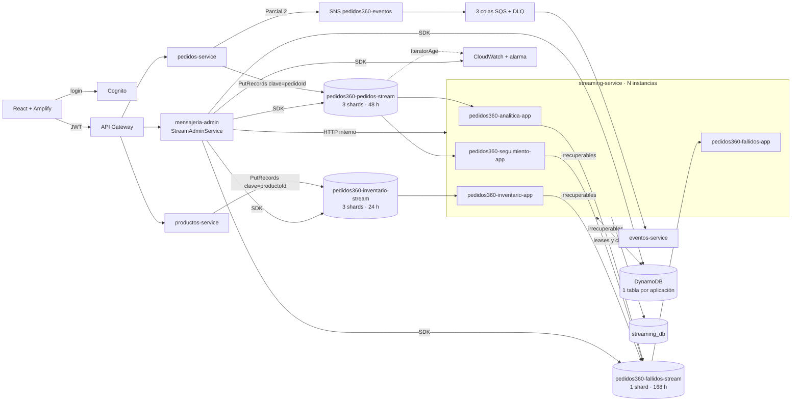
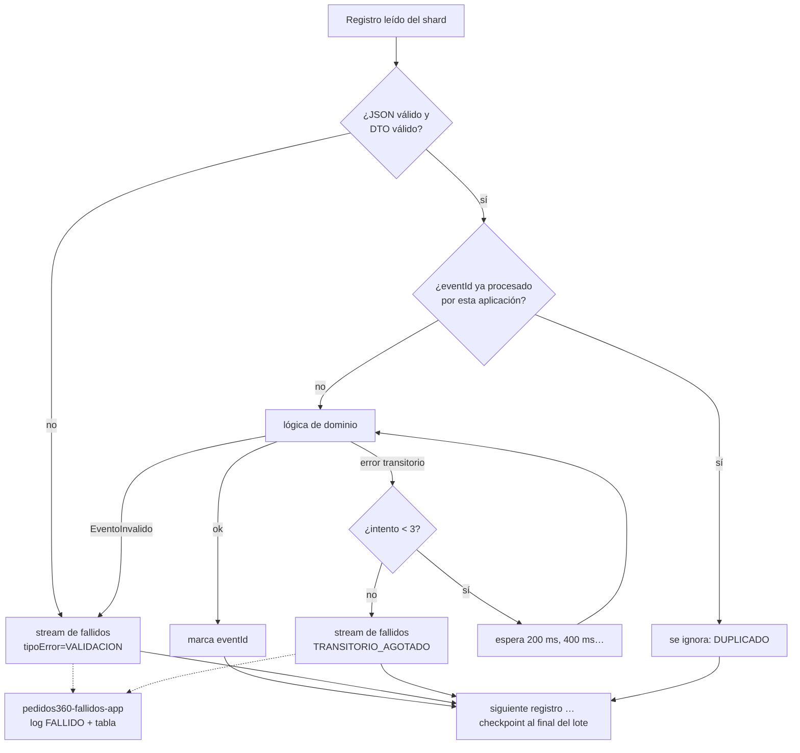

# Pedidos360

Sistema de gestión de pedidos desarrollado para las **Evaluaciones Parciales N°1, N°2 y N°3 — DSY1107 (Desarrollo Cloud Native I, DuocUC)**.

> **Parcial 2:** se agregó mensajería asíncrona con **Amazon SNS + SQS** (1 tópico, 3 colas con DLQ, fanout + filtro de suscripción), dos microservicios nuevos (`eventos-service` y `mensajeria-admin`), monitoreo con **CloudWatch** y un panel de administración en el frontend. Todo está en la [sección 14](#14-mensajería-asíncrona-con-sns-y-sqs-parcial-2).

> **Parcial 3:** se agregó **streaming de eventos con Amazon Kinesis Data Streams**: 2 streams de negocio de 3 shards + 1 stream de mensajes fallidos, productores en `pedidos-service` y `productos-service`, un microservicio nuevo `streaming-service` con 4 aplicaciones consumidoras (KCL) organizadas por dominio, administración de streams en `mensajeria-admin` (`StreamAdminService`), alarma de CloudWatch y el panel **Streaming** del frontend. La mensajería SNS/SQS del Parcial 2 sigue igual. Todo está en la [sección 15](#15-streaming-de-eventos-con-amazon-kinesis-parcial-3).

Pedidos360 demuestra, de punta a punta, un flujo de autenticación y autorización real con **Amazon Cognito**, comunicación segura entre **microservicios Spring Boot**, y un **frontend React con AWS Amplify**, todo ejecutable localmente con Docker y listo para desplegar en AWS sin reescribir código.

---

## 1. Descripción

Pedidos360 es un sistema simple de gestión de pedidos con dos entidades de negocio (`Producto` y `Pedido`) pensado para **maximizar la demostración de los requisitos de la rúbrica** (Cognito, JWT, microservicios, roles, Docker, AWS) y minimizar la complejidad de negocio.

- Un usuario se autentica con Cognito (registro/login vía Amplify Authenticator).
- Puede ver productos y crear pedidos (rol `USER`).
- Un `ADMIN` además puede crear/editar/eliminar productos y cambiar el estado de un pedido.
- Al crear un pedido, `pedidos-service` valida y descuenta stock llamando en tiempo real a `productos-service`, reenviando el mismo JWT del usuario.

## 2. Arquitectura

```text
                         INTERNET
                             │
                             ▼
                  ┌────────────────────┐
                  │   React Frontend   │
                  │    AWS Amplify     │
                  └─────────┬──────────┘
                            │
                            ▼
                  ┌────────────────────┐
                  │  Amazon Cognito    │
                  │  Authentication    │
                  └─────────┬──────────┘
                            │ JWT
                            ▼
                  ┌────────────────────┐
                  │   API Gateway      │
                  └─────────┬──────────┘
                            │
                   ┌────────┴────────┐
                   ▼                 ▼
             ┌───────────┐     ┌───────────┐
             │    EC2    │     │    EC2    │
             │ Productos │     │ Pedidos   │
             │ Service   │────▶│ Service   │  (pedidos consulta productos)
             └─────┬─────┘     └─────┬─────┘
                   ▼                 ▼
            productos-db        pedidos-db
             (PostgreSQL)       (PostgreSQL)
                                     │ publica PEDIDO_CREADO / PEDIDO_ESTADO_ACTUALIZADO
                                     ▼
                         ┌───────────────────────┐        ┌────────────────────┐
                         │ SNS pedidos360-eventos │◀──────│  mensajeria-admin  │ (topología, colas,
                         └───┬────────┬────────┬──┘        │  API REST /admin)  │  DLQ, consumidores)
                  (fanout)   │ (filtro│ENVIO)  │ (fanout)  └────────────────────┘
                             ▼        ▼        ▼
                   notificaciones  despacho  auditoria   ← 3 colas SQS, cada una con su DLQ
                             └────────┼────────┘
                                      ▼
                              ┌───────────────┐
                              │ eventos-service│──▶ eventos-db (PostgreSQL)
                              └───────────────┘
```

El detalle de la mensajería (Parcial 2) está en la [sección 14](#14-mensajería-asíncrona-con-sns-y-sqs-parcial-2).

En **local**, el "API Gateway" se simula con un reverse proxy Nginx delante del frontend (ver sección 8), y las "instancias EC2" son contenedores Docker de cada microservicio. La lógica de negocio y de seguridad es idéntica en ambos entornos — solo cambian variables de entorno.

## 3. Tecnologías y versiones

| Componente | Tecnología | Versión |
| --- | --- | --- |
| Backend | Java | 21 (LTS) |
| Backend | Spring Boot | 3.3.4 |
| Backend | Maven | 3.9 |
| Backend | Spring Security OAuth2 Resource Server | (incluido en Spring Boot 3.3.4) |
| Base de datos | PostgreSQL | 16 |
| Frontend | Node.js | 20 LTS |
| Frontend | React | 18.3 |
| Frontend | Vite | 5.4 |
| Frontend | AWS Amplify (JS v6) / `@aws-amplify/ui-react` | 6.x |
| Frontend | React Router | 6.26 |
| Contenedores | Docker / Docker Compose | Docker Desktop reciente |
| AWS | Cognito, Amplify Hosting, API Gateway, EC2 | — |
| Mensajería (Parcial 2) | Spring Cloud AWS (SQS + SNS) | 3.2.1 |
| AWS (Parcial 2) | SNS, SQS, CloudWatch | — |

## 4. Requisitos

- Docker Desktop
- Node.js 20+ (solo si se quiere correr el frontend fuera de Docker)
- Java 21 y Maven (solo si se quiere correr un microservicio fuera de Docker)
- Git
- Una cuenta de AWS (para la parte de Cognito y el despliegue final)

## 5. Estructura del proyecto

```text
pedidos360/
├── frontend/                  # React + Vite + Amplify
├── backend/
│   ├── productos-service/     # Spring Boot — microservicio de productos
│   ├── pedidos-service/       # Spring Boot — pedidos (publica eventos en SNS)
│   ├── eventos-service/       # Parcial 2 — consumidores SQS por dominio + monitor de DLQ
│   ├── mensajeria-admin/      # Parcial 2 — topología SNS/SQS + API REST de administración
│   │                          # Parcial 3 — StreamAdminService: administración de streams Kinesis
│   └── streaming-service/     # Parcial 3 — aplicaciones consumidoras Kinesis (KCL) por dominio
├── infra/                     # Parcial 2 — scripts PowerShell (CloudWatch, demo, limpieza)
├── .github/workflows/         # CI: compila y prueba todos los componentes
├── docker-compose.yml
├── .env.example
└── README.md
```

## 6. Instalación local

```bash
git clone <URL_DEL_REPOSITORIO>
cd pedidos360
cp .env.example .env
# Edita .env con los datos de tu User Pool de Cognito (ver sección 7)
docker compose up --build
```

Servicios expuestos:

| Servicio | URL local |
| --- | --- |
| Frontend | http://localhost:3000 |
| productos-service | http://localhost:8081 (Swagger: `/swagger-ui.html`) |
| pedidos-service | http://localhost:8082 (Swagger: `/swagger-ui.html`) |
| productos-db | localhost:5433 |
| pedidos-db | localhost:5434 |
| eventos-service (Parcial 2) | http://localhost:8083 (Swagger: `/swagger-ui.html`) |
| mensajeria-admin (Parcial 2) | http://localhost:8090 (Swagger: `/swagger-ui.html`) |
| eventos-db (Parcial 2) | localhost:5435 |
| streaming-service (Parcial 3) | http://localhost:8085 (Swagger: `/swagger-ui.html`) |
| streaming-db (Parcial 3) | localhost:5436 |

Para el Parcial 2, `.env` también debe tener las credenciales del Learner Lab (`AWS_ACCESS_KEY_ID`, `AWS_SECRET_ACCESS_KEY`, `AWS_SESSION_TOKEN`). Ver sección 14.

## 7. Configuración de Cognito (paso a paso)

### 7.1 Crear el User Pool

1. Consola AWS → **Cognito** → **User pools** → **Create user pool**.
2. **Configure sign-in experience**: Cognito user pool sign-in options → `Email`.
3. **Configure security requirements**: password policy por defecto, MFA → `No MFA` (para simplificar el laboratorio).
4. **Configure sign-up experience**: Self-service sign-up activado, Required attributes → `email`.
5. **Configure message delivery**: Email provider → `Send email with Cognito`.
6. **Integrate your app**:
   - User pool name: `pedidos360-pool`
   - Use the Cognito Hosted UI: activado (opcional, útil para probar con Postman)
   - App type: `Public client`
   - App client name: `pedidos360-app`
   - Client secret: **Don't generate a client secret** (obligatorio: Amplify usa PKCE, no secreto)
   - Allowed callback URLs: `http://localhost:3000/` (agrega también la URL de Amplify Hosting cuando la tengas)
7. **Create user pool**.

Dónde sacar el **User Pool ID**: pestaña *Overview* del User Pool → campo *User pool ID* (formato `us-east-1_XXXXXXXXX`).

Dónde sacar el **App Client ID**: *App integration* → *App clients* → tu app client → campo *Client ID*.

### 7.2 Crear los grupos de roles

1. Tu User Pool → **Groups** → **Create group**.
2. Crea el grupo `USER` (sin rol IAM asociado, solo se usa como claim).
3. Crea el grupo `ADMIN`.
4. Asigna manualmente cada usuario de prueba a su grupo: **Users** → selecciona el usuario → **Add to group**.

Cognito incluye automáticamente los grupos del usuario en el ID Token como el claim `cognito:groups`, que es exactamente lo que leen los microservicios (`CognitoGroupsAuthoritiesConverter`) y el frontend (`getUsuarioActual`).

### 7.3 Obtener el Issuer URL (para el backend)

Tu User Pool → **Overview** → campo **OpenID Connect configuration URL**, con esta forma:

```text
https://cognito-idp.<region>.amazonaws.com/<USER_POOL_ID>/.well-known/openid-configuration
```

El `COGNITO_ISSUER_URI` que usan los microservicios es **esa misma URL sin el sufijo** `/.well-known/openid-configuration`:

```text
COGNITO_ISSUER_URI=https://cognito-idp.us-east-1.amazonaws.com/us-east-1_XXXXXXXXX
```

Con eso, `NimbusJwtDecoder.withIssuerLocation(...)` descubre automáticamente el JWKS y valida **firma, expiración e issuer** de cada token.

### 7.4 Configurar variables de entorno

Edita `.env` en la raíz del proyecto:

```env
COGNITO_ISSUER_URI=https://cognito-idp.us-east-1.amazonaws.com/us-east-1_XXXXXXXXX
CORS_ALLOWED_ORIGINS=http://localhost:3000
VITE_API_URL=
VITE_COGNITO_REGION=us-east-1
VITE_COGNITO_USER_POOL_ID=us-east-1_XXXXXXXXX
VITE_COGNITO_USER_POOL_CLIENT_ID=xxxxxxxxxxxxxxxxxxxxxxxxxx
```

`VITE_API_URL` se deja **vacío** cuando se usa Docker Compose: el frontend queda servido por Nginx, que hace de reverse proxy hacia ambos microservicios (ver sección 8), simulando el rol de API Gateway.

## 8. API local (Nginx como API Gateway simplificado)

`frontend/nginx.conf` expone un único punto de entrada:

```text
React (puerto 3000, servido por Nginx)
  ├── /api/productos → productos-service:8081
  ├── /api/pedidos   → pedidos-service:8082
  └── /api/admin     → mensajeria-admin:8090   (Parcial 2)
```

Así, `apiFetch()` siempre llama a rutas relativas (`/api/productos`, `/api/pedidos`), y en AWS basta con apuntar `VITE_API_URL` a la Invoke URL de API Gateway — **la lógica de React no cambia**.

## 9. Roles y autorización

| Endpoint | USER | ADMIN |
| --- | --- | --- |
| `GET /api/productos` | ✅ | ✅ |
| `GET /api/productos/{id}` | ✅ | ✅ |
| `POST /api/productos` | ❌ (403) | ✅ |
| `PUT /api/productos/{id}` | ❌ (403) | ✅ |
| `DELETE /api/productos/{id}` | ❌ (403) | ✅ |
| `GET /api/pedidos` | ✅ | ✅ |
| `GET /api/pedidos/{id}` | ✅ | ✅ |
| `POST /api/pedidos` | ✅ | ✅ |
| `PUT /api/pedidos/{id}/estado` | ❌ (403) | ✅ |
| `/api/admin/**` (mensajeria-admin, Parcial 2) | ❌ (403) | ✅ |

La autorización se aplica en `SecurityConfig` de cada microservicio usando `hasRole(...)` sobre las authorities derivadas del claim `cognito:groups` — no es una comprobación del nombre de usuario.

## 10. Pruebas

### 10.1 Automatizadas (JUnit)

```bash
cd backend/productos-service && mvn test
cd backend/pedidos-service && mvn test
cd backend/eventos-service && mvn test     # Parcial 2: ACK manual, idempotencia y DLQ (Mockito, sin AWS)
cd backend/mensajeria-admin && mvn test    # Parcial 2: validación de la topología declarada · Parcial 3: declaración de streams
cd backend/streaming-service && mvn test   # Parcial 3: validación, reintentos, duplicados y stream de fallidos (sin AWS)
```

Además, GitHub Actions (`.github/workflows/build.yml`) compila y prueba los 5 microservicios y el frontend en cada push.

Cubren: creación/consulta de productos, error 404 al pedir un producto inexistente, error de stock insuficiente, creación de pedidos con `ProductosClient` simulado (Mockito), cambio de estado de un pedido.

La validación real de JWT (firma/issuer/expiración/roles) requiere un User Pool real, por lo que las pruebas 401/403 listadas abajo se verifican manualmente contra Cognito, como pide la rúbrica.

### 10.2 Manuales (contra Cognito real)

1. Registrarse desde `/login` (Authenticator de Amplify).
2. Iniciar sesión.
3. Cerrar sesión.
4. Con sesión iniciada, entrar a `/dashboard` → debe funcionar.
5. Sin sesión (o en incógnito), intentar entrar a `/dashboard` → debe redirigir a `/login`.
6. Confirmar en las DevTools que el frontend obtiene el ID Token de Cognito.
7. Confirmar que cada llamada a `/api/...` incluye `Authorization: Bearer <JWT>`.
8. Confirmar que el backend rechaza peticiones sin ese header.
9. Petición sin token (`curl` sin header) → `401`.
10. Token manipulado/inválido → `401`.
11. Token expirado (esperar a que expire o editarlo) → `401`.
12. Usuario del grupo `USER` intentando `POST /api/productos` → `403`.
13. Usuario del grupo `ADMIN` haciendo lo mismo → `200/201`.
14. Crear un producto como `ADMIN`.
15. Consultar ese producto como `USER`.
16. Crear un pedido con ese producto como `USER`.
17. Consultar el pedido creado.
18. Verificar que `pedidos-service` consultó `productos-service` (revisar logs de `productos-service`: debe registrar la petición de `reservar-stock`).

Ejemplo de prueba 9 con `curl`:

```bash
curl -i http://localhost:8081/api/productos
# Debe responder 401 Unauthorized
```

## 11. Checklist de rúbrica

| Requisito | Implementación | Archivo | Cómo demostrarlo |
| --- | --- | --- | --- |
| React | SPA con Vite | `frontend/src/App.jsx` | `npm run dev` o Docker |
| Amplify | `Amplify.configure` con Cognito | `frontend/src/amplifyConfig.js` | Login funcional |
| Authenticator | `<Authenticator>` de `@aws-amplify/ui-react` | `frontend/src/pages/Login.jsx` | Pantalla `/login` |
| Login/Logout | Flujo completo Amplify | `Login.jsx`, `Navbar.jsx` | Pruebas 1-3 |
| Rutas protegidas | `ProtectedRoute` + `useAuthenticator` | `frontend/src/router/ProtectedRoute.jsx` | Prueba 5 |
| JWT | ID Token de Cognito vía `fetchAuthSession` | `frontend/src/services/apiFetch.js` | Prueba 6 |
| apiFetch | Helper centralizado con header `Authorization` | `apiFetch.js` | Prueba 7 |
| Claims | Lectura de `email` / `cognito:groups` | `getUsuarioActual()`, `Dashboard.jsx` | Vista Dashboard |
| Roles | Grupos Cognito `USER`/`ADMIN` | Grupos Cognito + UI condicional | Sección 9 |
| Microservicio 1 | `productos-service` (Spring Boot, CRUD) | `backend/productos-service/` | `mvn test`, Swagger |
| Microservicio 2 | `pedidos-service` (Spring Boot, consume productos) | `backend/pedidos-service/` | `mvn test`, Swagger |
| Spring Security | OAuth2 Resource Server en ambos servicios | `config/SecurityConfig.java` (cada servicio) | Pruebas 9-13 |
| Firma JWT | `NimbusJwtDecoder` vía JWKS del issuer | `SecurityConfig.jwtDecoder()` | Prueba 10 |
| Issuer | `withIssuerLocation(issuerUri)` | `application.yml` → `cognito.issuer-uri` | Prueba 10 |
| Expiración | Validada automáticamente por `NimbusJwtDecoder` | — | Prueba 11 |
| 401 | Sin token / token inválido / expirado | Spring Security (Resource Server) | Pruebas 9-11 |
| 403 | Rol insuficiente | `hasRole(...)` en `SecurityConfig` | Prueba 12 |
| PostgreSQL | Una BD por microservicio | `docker-compose.yml` | `productos-db`, `pedidos-db` |
| Docker | Dockerfile por componente | `*/Dockerfile` | `docker compose up --build` |
| API Gateway | Nginx (local) / API Gateway (AWS) | `frontend/nginx.conf`, sección 13 | Prueba 7 vía `/api/...` |
| EC2 | Guía de despliegue | Sección 13.3 | — |
| Base de datos cloud | RDS PostgreSQL | Sección 13.4 | — |
| GitHub | `.gitignore` por componente, sin secretos | `.gitignore` (raíz, `frontend/`, `backend/`) | Revisión del repo |

## 12. Guion de presentación (5-10 min)

1. Mostrar el diagrama de arquitectura (sección 2).
2. Login con Cognito (Authenticator) — registrar o usar un usuario existente.
3. Mostrar el Dashboard con el email y el rol leídos del JWT.
4. Mostrar la página de Productos (como `USER`: solo lectura; como `ADMIN`: crear uno).
5. Crear un pedido y mostrar el total calculado.
6. Abrir DevTools → Network → mostrar el header `Authorization: Bearer ...` en una petición.
7. `curl` sin token → mostrar `401`.
8. Con un usuario `USER`, intentar `POST /api/productos` desde Postman → mostrar `403`.
9. Mostrar Docker Desktop con los contenedores corriendo.
10. Mostrar el código de `SecurityConfig` explicando la validación de firma/issuer/expiración/roles.
11. Explicar en 1-2 minutos qué variables cambian para desplegar en AWS (sección 13).

## 13. Despliegue en AWS

> Esta guía indica **qué crear y qué variables cambiar**. No inventa IDs, ARNs ni URLs: cada uno se obtiene desde la consola de AWS al momento de crear el recurso, tal como se explicó en la sección 7 para Cognito.

### 13.1 Cognito

Ya creado en la sección 7 (`User Pool`, `App Client`, grupos `USER`/`ADMIN`). Solo debes:

- Agregar la URL de Amplify Hosting a **Allowed callback URLs** del App Client.

### 13.2 Amplify Hosting (frontend)

1. AWS Amplify → **Host your web app** → conecta el repositorio de GitHub del frontend.
2. En **Environment variables**, configura:
   - `VITE_API_URL` = Invoke URL de tu API Gateway (sección 13.4)
   - `VITE_COGNITO_REGION`, `VITE_COGNITO_USER_POOL_ID`, `VITE_COGNITO_USER_POOL_CLIENT_ID`
3. Build command: `npm run build`. Output directory: `dist`.
4. Deploy. Amplify entrega una URL pública — agrégala a los callback URLs de Cognito (paso anterior).

### 13.3 EC2 (backend)

Para cada microservicio (`productos-service`, `pedidos-service`):

1. Lanzar una instancia EC2 (ej. Amazon Linux 2023, t3.micro).
2. **Security Group**: abrir el puerto de la app (8081 u 8082) solo desde el Security Group de API Gateway/VPC Link, y el puerto 22 solo desde tu IP.
3. Instalar Docker en la instancia (`sudo yum install docker -y && sudo systemctl start docker`).
4. Copiar el proyecto (`git clone` del repo backend) y ejecutar:
   ```bash
   docker build -t productos-service ./productos-service
   docker run -d -p 8081:8081 \
     -e DB_HOST=<endpoint-rds> \
     -e DB_NAME=productos_db \
     -e DB_USERNAME=<usuario> \
     -e DB_PASSWORD=<password> \
     -e COGNITO_ISSUER_URI=<issuer-de-la-sección-7.3> \
     -e CORS_ALLOWED_ORIGINS=<url-de-amplify> \
     productos-service
   ```
5. Repetir para `pedidos-service`, agregando además `PRODUCTOS_SERVICE_URL=http://<IP-privada-EC2-productos>:8081`.

### 13.4 API Gateway

1. Crear una **HTTP API** (más simple que REST API para este caso).
2. Crear un **JWT Authorizer**:
   - Issuer URL: el mismo `COGNITO_ISSUER_URI` de la sección 7.3.
   - Audience: el **App Client ID** de Cognito.
3. Crear las rutas e integraciones:
   - `ANY /api/productos/{proxy+}` → integración HTTP hacia `http://<IP-privada-EC2-productos>:8081/api/productos/{proxy}`
   - `ANY /api/pedidos/{proxy+}` → integración HTTP hacia `http://<IP-privada-EC2-pedidos>:8082/api/pedidos/{proxy}`
   - `ANY /api/admin/{proxy+}` → integración HTTP hacia `http://<IP-privada-EC2-admin>:8090/api/admin/{proxy}` (Parcial 2)
4. Adjuntar el JWT Authorizer a todas las rutas. `eventos-service` **no** se publica en API Gateway: solo lo llama `mensajeria-admin` por la red interna.
5. Desplegar (`Deploy`) y copiar la **Invoke URL** → esa es tu `VITE_API_URL`.

> Nota: si las instancias EC2 están en una VPC privada, API Gateway debe conectarse mediante un **VPC Link**; documentar esa configuración excede el alcance de esta guía y depende de la VPC concreta que se use — indicarlo explícitamente en la presentación si no se dispone de esos datos.

### 13.5 Base de datos cloud

Usar **Amazon RDS para PostgreSQL** (una instancia `db.t3.micro` es suficiente), creando una base de datos lógica por microservicio (`productos_db`, `pedidos_db`) dentro de la misma instancia, o dos instancias separadas si se prefiere aislamiento total. Apuntar `DB_HOST`/`DB_NAME`/`DB_USERNAME`/`DB_PASSWORD` de cada microservicio al endpoint de RDS correspondiente.

### 13.6 Resumen de variables que cambian (LOCAL → AWS)

| Variable | Local | AWS |
| --- | --- | --- |
| `VITE_API_URL` | *(vacío, usa Nginx)* | Invoke URL de API Gateway |
| `DB_HOST` | `productos-db` / `pedidos-db` (contenedor) | Endpoint de RDS |
| `PRODUCTOS_SERVICE_URL` | `http://productos-service:8081` | `http://<IP-privada-EC2>:8081` |
| `CORS_ALLOWED_ORIGINS` | `http://localhost:3000` | URL de Amplify Hosting |
| `COGNITO_ISSUER_URI` | Igual en ambos entornos (mismo User Pool) | Igual |
| `AWS_ACCESS_KEY_ID` / `AWS_SECRET_ACCESS_KEY` / `AWS_SESSION_TOKEN` | Credenciales del Learner Lab en `.env` | No se usan: la EC2 toma el rol **LabRole** (Instance profile) |
| `EVENTOS_SERVICE_URLS` (admin) | `http://eventos-service:8083` | `http://<IP-privada-EC2-eventos>:8083` (separadas por coma si hay varias instancias) |
| `STREAMING_SERVICE_URLS` (admin, Parcial 3) | `http://streaming-service:8085,http://streaming-service-2:8085` | `http://<IP-privada-EC2-streaming-1>:8085,http://<IP-privada-EC2-streaming-2>:8085` |
| `INSTANCIA_ID` (streaming-service, Parcial 3) | `streaming-1` / `streaming-2` | Un nombre distinto por EC2 (`streaming-ec2-1`, `streaming-ec2-2`) |

La lógica de negocio y de seguridad (Java, React) **no cambia**: solo configuración.

---

## 14. Mensajería asíncrona con SNS y SQS (Parcial 2)

Al crear un pedido o cambiar su estado, `pedidos-service` responde de inmediato y **publica un evento** en un tópico SNS. Notificar al cliente, preparar el despacho y auditar se hacen **en segundo plano** en `eventos-service`, con reintentos, DLQ y monitoreo. Si un consumidor cae, los pedidos se siguen creando y los mensajes esperan en su cola.

### 14.1 Topología (1 tópico → 3 colas, cada una con su DLQ)

| Cola | Qué hace (dominio) | Recibe | DLQ | Retención cola | Retención DLQ | Visibility |
| --- | --- | --- | --- | --- | --- | --- |
| `pedidos360-notificaciones-q` | Correo al cliente por cada cambio del pedido | **Todos** los eventos (fanout) | `pedidos360-notificaciones-dlq` | 1 día | 14 días | 15 s |
| `pedidos360-despacho-q` | Crea y actualiza la orden de despacho a domicilio | **Solo** `tipoEntrega = ENVIO` (filter policy) | `pedidos360-despacho-dlq` | 4 días | 14 días | 15 s |
| `pedidos360-auditoria-q` | Guarda el historial de cada pedido en la BD | **Todos** los eventos (fanout) | `pedidos360-auditoria-dlq` | 7 días | 14 días | 15 s |

- Tópico: `pedidos360-eventos`. Suscripciones con **raw message delivery** (la cola recibe el JSON del evento tal cual).
- Redrive Policy en las 3 colas: **maxReceiveCount = 3**.
- Atributos de cada mensaje (los que evalúan los filtros): `tipoEvento`, `tipoEntrega`, `estado`, `eventoId`.
- Filtro de la suscripción de despacho: `{"tipoEntrega":["ENVIO"]}` (se evalúa sobre los atributos del mensaje, el scope por defecto de SNS).

**Dos patrones de enrutamiento:** *fanout* (notificaciones y auditoría reciben todo) y *entrega selectiva por filtro* (un pedido con retiro en tienda nunca llega a despacho, sin que el publicador sepa quién consume).

### 14.2 Justificación de parámetros

| Parámetro | Valor | Por qué |
| --- | --- | --- |
| Visibility timeout | 15 s | Procesar un mensaje toma ~1 s. 15 s da margen holgado sin dejar un mensaje "atascado" mucho tiempo si la instancia cae: a los 15 s otra instancia lo retoma. |
| maxReceiveCount | 3 | Suficiente para superar una falla breve (3 intentos ≈ 45 s). Más intentos retrasan la detección de un problema real. |
| Retención notificaciones | 1 día | Un aviso de hace más de un día ya no le sirve al cliente. |
| Retención despacho | 4 días | Cubre un fin de semana largo con el consumidor caído sin perder despachos. |
| Retención auditoría | 7 días | La trazabilidad no se puede perder; es la cola más tolerante. |
| Retención DLQ | 14 días (máximo de SQS) | Tiempo para diagnosticar y reprocesar. Siempre ≥ la retención de su cola (lo valida `TopologiaMensajeria`). |
| Raw message delivery | true | El consumidor recibe el evento JSON sin el sobre de SNS y los atributos SNS llegan como atributos SQS. |
| Purga | Manual, desde el admin | La DLQ se purga solo después de revisar la causa (log `[DLQ]` / tabla `registros_dlq`) y reprocesar lo recuperable. Las colas de trabajo no se purgan en producción. |

> Un mensaje que **expira** por retención se borra: **no** pasa a la DLQ. Por eso la DLQ retiene más que la cola.

### 14.3 Recorrido de un mensaje y manejo de errores

1. `PedidoService` guarda el pedido y llama a `EventoPublisher.publicar(...)`. La lógica de negocio no conoce SNS.
2. `SnsEventoPublisher` publica el JSON en `pedidos360-eventos` con sus atributos.
3. SNS lo copia a cada cola cuyo filtro coincide.
4. En `eventos-service`, cada `@SqsListener` (ACK **MANUAL**) delega en `ProcesadorMensajes`:
   - **Duplicado** (el `eventoId` ya está en la tabla `mensajes_procesados`) → ACK y se ignora. La tabla es compartida, así que funciona con varias instancias.
   - **Éxito** → registra el `eventoId` y hace **ACK** explícito (`ack.acknowledge()`).
   - **Error transitorio** (`ErrorTransitorio`, p. ej. proveedor de correo caído) → **sin ACK**. A los 15 s el mensaje vuelve a ser visible y se reintenta. En el 3.er intento (= maxReceiveCount) el consumidor lo envía él mismo a la DLQ **con la causa** y hace ACK. La Redrive Policy queda como red de seguridad: si la instancia cae antes de poder enviarlo, SQS lo mueve igual.
   - **Error definitivo** (`ErrorDefinitivo`, p. ej. JSON inválido o total ≤ 0) → se envía **directo a la DLQ** con los atributos `causa`, `intento`, `consumidor` y `colaOrigen`, y luego ACK. Reintentar un dato inválido no sirve.
5. `DlqMonitor` revisa las 3 DLQ cada 15 s (sin borrar ni ocultar mensajes) y registra **una vez** cada mensaje en el log y en la tabla `registros_dlq`: `[DLQ] cola=… messageId=… eventoId=… pedido=… intento=… causa="…"`.
6. CloudWatch dispara la alarma de esa DLQ y envía un correo.
7. Desde `mensajeria-admin` (o el panel **Mensajería** del frontend) se **reprocesa** la DLQ: los mensajes vuelven a su cola **con sus atributos originales**. Los transitorios se procesan; los definitivos vuelven a la DLQ.

### 14.4 Dónde está cada cosa

| Requisito | Archivo |
| --- | --- |
| Topología declarada en código (tópico, colas, DLQ, Redrive, suscripciones, filtros) | `backend/mensajeria-admin/.../config/TopologiaMensajeria.java` + `application.yml` (`mensajeria.topologia`) |
| Aplicación idempotente de la topología al iniciar | `mensajeria-admin/.../service/TopologiaService.java`, `TopologiaInicializador.java` |
| Publicador separado del negocio | `pedidos-service/.../messaging/EventoPublisher.java`, `SnsEventoPublisher.java` |
| Consumidores por dominio con ACK manual | `eventos-service/.../notificaciones/`, `despacho/`, `auditoria/` (`*Listener.java`) |
| Reintentos, DLQ directa y duplicados | `eventos-service/.../comun/ProcesadorMensajes.java`, `ControlDuplicados.java` |
| Consumidor de DLQ para logs (id, intento, causa) | `eventos-service/.../dlq/DlqMonitor.java` |
| Pausar / reanudar consumidores en otro microservicio | `eventos-service/.../control/ConsumidoresController.java` ← `mensajeria-admin/.../service/ConsumidorService.java` |
| Configuración centralizada (nombres, IDs de listener) | `application.yml` de cada servicio (`mensajeria.*`); los `@SqsListener` usan `${mensajeria.consumidores.*}` |
| Panel de administración (ADMIN) | `frontend/src/pages/Mensajeria.jsx` |
| Alarmas y dashboard de CloudWatch | `infra/1-crear-monitoreo.ps1` |

### 14.5 API de `mensajeria-admin` (Swagger en `http://localhost:8090/swagger-ui.html`)

Todas las rutas exigen un JWT de Cognito del grupo **ADMIN** (`SEGURIDAD_HABILITADA=true`).

| Método | Ruta | Acción |
| --- | --- | --- |
| GET | `/api/admin/topologia` | Ver la topología declarada |
| POST | `/api/admin/topologia/aplicar` | Crear o actualizar en AWS todo lo declarado (idempotente) |
| GET | `/api/admin/colas?prefijo=pedidos360` | Estado de las colas: disponibles, en proceso, DLQ, retención |
| GET | `/api/admin/colas/{nombre}` | Estado de una cola |
| POST | `/api/admin/colas` | Crear cola (opcional: DLQ + Redrive) |
| DELETE | `/api/admin/colas/{nombre}` | Eliminar cola |
| POST | `/api/admin/colas/{nombre}/purgar` | Purgar cola |
| POST | `/api/admin/colas/{nombre}/dlq/reprocesar` | Devolver los mensajes de su DLQ a la cola |
| POST | `/api/admin/colas/{nombre}/dlq/purgar` | Purgar su DLQ |
| GET | `/api/admin/topicos` | Listar tópicos |
| POST / DELETE | `/api/admin/topicos/{nombre}` | Crear / eliminar tópico |
| GET | `/api/admin/topicos/{nombre}/suscripciones` | Suscripciones con filtro y raw delivery |
| POST | `/api/admin/topicos/{nombre}/suscripciones` | Suscribir una cola (`{"cola":"…","filtro":"{…}","rawMessageDelivery":true}`) |
| DELETE | `/api/admin/suscripciones?arn=…` | Eliminar suscripción |
| POST | `/api/admin/topicos/{nombre}/publicar` | Publicar un mensaje de prueba con atributos |
| GET | `/api/admin/consumidores` | Estado de cada listener en cada instancia de `eventos-service` |
| POST | `/api/admin/consumidores/{id}/pausar` · `/reanudar` | Pausar / reanudar (`consumidor-notificaciones`, `consumidor-despacho`, `consumidor-auditoria`) |

### 14.6 Monitoreo (CloudWatch)

`infra/1-crear-monitoreo.ps1 -Correo <tu correo>` crea:

- El tópico `pedidos360-alertas` con suscripción por correo.
- 3 alarmas, una por DLQ: `ApproximateNumberOfMessagesVisible > 0` (Maximum, 1 minuto).
- El dashboard **Pedidos360-Mensajeria**, con las 4 métricas por cola:

| Métrica | CloudWatch | Qué decisión permite |
| --- | --- | --- |
| Mensajes disponibles | `ApproximateNumberOfMessagesVisible` | Si crece sostenidamente, faltan consumidores: escalar instancias. |
| Mensajes en proceso | `ApproximateNumberOfMessagesNotVisible` | Si se queda alto, el procesamiento es lento o las instancias caen sin ACK. |
| Antigüedad del más antiguo | `ApproximateAgeOfOldestMessage` | Si se acerca a la retención, hay riesgo de perder mensajes. |
| Mensajes en DLQ | `ApproximateNumberOfMessagesVisible` (DLQ) | > 0 = hay fallos: revisar la causa y reprocesar o purgar. |

### 14.7 Ejecutar en local

```powershell
Copy-Item .env.example .env     # completar Cognito + credenciales del Learner Lab
docker compose up -d --build
docker compose logs -f eventos-service mensajeria-admin
```

Al iniciar, `mensajeria-admin` crea la topología en AWS (`[topologia] …` en su log). Plan B sin Docker: `infra/2-crear-topologia-cli.ps1`.

Segunda instancia de consumidores (demo de escalamiento): `infra/4-segunda-instancia.ps1`.

### 14.8 Despliegue en AWS (servicios nuevos)

- `eventos-service` y `mensajeria-admin` se despliegan igual que los del Parcial 1 (sección 13.3), con el rol **LabRole** como *Instance profile* de la EC2 (así no se ponen credenciales en la instancia).
- `eventos-service`: `DB_HOST` apunta a RDS (base `eventos_db`). Para escalar, se lanzan más instancias: todas consumen las mismas colas.
- `mensajeria-admin`: `EVENTOS_SERVICE_URLS` con las IP privadas de las instancias de `eventos-service`; ruta `/api/admin/{proxy+}` en API Gateway (sección 13.4).

### 14.9 Limitaciones conocidas

- La publicación ocurre después de guardar el pedido y no en la misma transacción: si SNS falla en ese instante, el error queda en el log, pero el pedido no se revierte. La solución completa sería un *transactional outbox*.
- `DlqMonitor` lee las DLQ con `VisibilityTimeout = 0` para no ocultar mensajes. Cada lectura incrementa su `ApproximateReceiveCount` en la DLQ, por eso el "intento" se toma del atributo `intento` que agrega el consumidor (o de `maxReceiveCount` si el mensaje lo movió la Redrive Policy).
- Pausar un consumidor afecta a las instancias listadas en `EVENTOS_SERVICE_URLS` (en Docker Compose: `eventos-service` y `eventos-service-2`). Si una no está corriendo, el panel la muestra como "Instancia no disponible".
- Suscribir una cola desde el admin reemplaza la *policy* de esa cola por una que autoriza solo a ese tópico.

---

## 15. Streaming de eventos con Amazon Kinesis (Parcial 3)

Kinesis **complementa** la mensajería del Parcial 2, no la reemplaza. Cuando se crea un pedido o cambia su estado, `pedidos-service` publica el evento en **SNS** (notificar, despachar, auditar: tareas que se hacen una vez y se borran) **y** en **Kinesis** (analítica y seguimiento en tiempo real: lecturas que varias aplicaciones hacen sobre el mismo flujo, cada una a su ritmo, con posibilidad de releer). `productos-service` publica cada movimiento de stock en un segundo stream.

### 15.1 Arquitectura



**Qué administra AWS y qué administra el equipo**

| AWS (servicio gestionado) | Equipo |
| --- | --- |
| Servidores, almacenamiento y red del stream | Cantidad de shards y modo de capacidad de cada stream |
| Replicación síncrona de cada registro en **3 zonas de disponibilidad** antes de confirmar el `PutRecord` | Retención de cada stream |
| Retención y orden de los registros dentro de cada shard | Clave de partición (qué orden se garantiza) |
| Métricas del stream en CloudWatch | Aplicaciones consumidoras (nombre, cuántas instancias) y su **tabla de coordinación** en DynamoDB |
| Escalado del almacenamiento de DynamoDB (on demand) | Checkpoints, manejo de errores, alarma |

No se levantan brokers, nodos de coordinación ni docker-compose para Kinesis: el `docker-compose.yml` solo ejecuta los microservicios.

**Disponibilidad y tolerancia a fallos:** si cae una zona, el stream sigue disponible (réplicas en las otras dos). Si cae una instancia de `streaming-service`, sus *leases* en DynamoDB dejan de renovarse y en ~10 s otra instancia de la misma aplicación los toma y continúa **desde el último checkpoint**. Lo que la instancia caída alcanzó a procesar sin checkpoint se vuelve a leer, y el control de duplicados por `eventId` evita procesarlo dos veces.

### 15.2 Streams y justificación de parámetros

Declarados en `backend/mensajeria-admin/src/main/resources/application.yml` (`streaming.streams`), aplicados por `StreamAdminService` (al iniciar o con `POST /api/admin/streams/aplicar`). Plan B equivalente por CLI: `infra/6-kinesis-streams.ps1`.

| Stream | Modo | Shards | Retención | Clave de partición | Por qué |
| --- | --- | --- | --- | --- | --- |
| `pedidos360-pedidos-stream` | PROVISIONED | 3 | 48 h | `pedidoId` | Lo leen 2 aplicaciones. 3 shards dan hasta 3.000 registros/s (3 MB/s) de escritura y permiten repartir la lectura entre hasta 3 instancias por aplicación. 48 h para reprocesar si una aplicación estuvo caída o hay que recalcular la analítica. |
| `pedidos360-inventario-stream` | PROVISIONED | 3 | 24 h | `productoId` | Un evento por producto de cada pedido (más volumen que pedidos). La alerta de stock bajo pierde valor rápido: basta la retención mínima, que es la más barata. |
| `pedidos360-fallidos-stream` | PROVISIONED | 1 | 168 h | aplicación que falló | Bajo volumen: 1 shard sobra. 7 días para diagnosticar y reprocesar; siempre retiene más que los de negocio (lo valida `DeclaracionStreams`). |

- **Restricción del AWS Academy Learner Lab:** la política de la cuenta (SCP) bloquea `kinesis:IncreaseStreamRetentionPeriod`, así que en el lab los streams quedan con la retención por defecto (24 h). Los valores de la tabla son el diseño justificado y están declarados en el código: `StreamAdminService` intenta aplicarlos y, si la cuenta lo rechaza, informa `OMITIDO … no permitido por la política de la cuenta` y sigue con el resto. En una cuenta normal se aplican sin cambios.
- **PROVISIONED y no ON_DEMAND:** la cantidad de shards es fija y conocida (3), el costo es predecible y se puede demostrar el reparto de shards entre instancias. ON_DEMAND conviene cuando el tráfico es impredecible.
- **Capacidad de un shard:** escritura 1 MB/s o 1.000 registros/s; lectura 2 MB/s y 5 `GetRecords`/s, compartidos por todas las aplicaciones que leen el stream. Por eso cada aplicación lee cada 1 s (`kinesis.lectura.intervalo-ms`).
- **Clave de partición y orden:** Kinesis aplica MD5 a la clave y la ubica en el rango de hash de un shard. Todos los eventos de un mismo pedido caen en el mismo shard y se leen en orden (creado → confirmado → listo). Pedidos distintos se reparten entre los 3 shards. El orden **entre** pedidos distintos no se garantiza, y no hace falta.
- **Métricas por shard:** `StreamAdminService` habilita `IncomingRecords`, `OutgoingRecords` e `IteratorAgeMilliseconds` por shard (monitoreo mejorado) para ver la distribución del consumo.

### 15.3 Diseño de los eventos (DTO + JSON)

```jsonc
{
  "eventId": "6f1c…",                  // único: control de duplicados (Kinesis entrega "al menos una vez")
  "tipoEvento": "PEDIDO_CREADO",       // PEDIDO_CREADO | PEDIDO_ESTADO_ACTUALIZADO
  "version": 1,                        // versión del contrato: permite evolucionarlo sin romper consumidores
  "ocurridoEn": "2026-11-24T21:00:00Z",// instante del hecho: el consumidor calcula la latencia del streaming
  "origen": "pedidos-service",         // trazabilidad
  "pedidoId": 42,                      // CLAVE DE PARTICIÓN
  "usuarioEmail": "cliente@pedidos360.cl",
  "estado": "PENDIENTE",
  "tipoEntrega": "ENVIO",
  "total": 19980.0,
  "cantidadItems": 2
}
```

`EventoInventario` (stream de inventario): `eventId`, `tipoEvento` (STOCK_RESERVADO, STOCK_BAJO, STOCK_AJUSTADO), `version`, `ocurridoEn`, `origen`, `productoId` (**clave**), `nombre`, `cantidad`, `stockRestante`. Con estos campos los consumidores no necesitan consultar otra API.

`EventoFallido` (stream de fallidos): conserva el `payloadOriginal` y todo el contexto para diagnosticar y reprocesar (`aplicacion`, `streamOrigen`, `shardId`, `sequenceNumber`, `eventIdOriginal`, `intentos`, `tipoError`, `causa`).

### 15.4 Productores

| Servicio | Clase | Stream |
| --- | --- | --- |
| `pedidos-service` | `streaming/KinesisStreamPublisher` (puerto `StreamPublisher`) | pedidos |
| `productos-service` | `streaming/KinesisInventarioPublisher` (puerto `InventarioPublisher`) | inventario |

Ambos usan `ProductorKinesis`: envía con **PutRecords** y **revisa cada entrada de la respuesta**. PutRecords puede responder 200 con parte de los registros rechazados (`FailedRecordCount > 0`, típicamente `ProvisionedThroughputExceededException`). Solo los rechazados se reenvían, con espera creciente (100 ms → 200 ms). Si se agotan los intentos, quedan en el log con `eventId` y causa. Una reserva de stock que deja el producto bajo el umbral envía `STOCK_RESERVADO` + `STOCK_BAJO` en **un solo lote**. La lógica de negocio (`PedidoService`, `ProductoService`) solo conoce la interfaz.

### 15.5 Aplicaciones consumidoras (consumer groups)

`streaming-service` ejecuta 4 aplicaciones KCL. Cada una tiene **nombre propio**, que es también el de su **tabla de coordinación en DynamoDB** (la crea la KCL), y lleva su propio checkpoint por shard.

| Aplicación | Stream | Dominio (paquete) | Qué hace |
| --- | --- | --- | --- |
| `pedidos360-analitica-app` | pedidos | `analitica/` | Ventas en línea: pedidos y montos totales, por minuto, por estado y por tipo de entrega |
| `pedidos360-seguimiento-app` | pedidos | `seguimiento/` | Estado actual de cada pedido y su línea de tiempo, con latencia y shard de origen |
| `pedidos360-inventario-app` | inventario | `inventario/` | Stock proyectado y alertas de stock bajo |
| `pedidos360-fallidos-app` | fallidos | `fallidos/` | Registra cada fallido (log `[FALLIDO]` y tabla `registros_fallidos`) |

**Dos aplicaciones distintas sobre el mismo stream:** analítica y seguimiento leen `pedidos360-pedidos-stream` en paralelo, cada una a su ritmo. Si la analítica se detiene, el seguimiento sigue al día y la analítica retoma desde su checkpoint (los eventos siguen retenidos 48 h). Con SQS esto no es posible: el primer consumidor borra el mensaje.

**Varias instancias:** cada instancia de `streaming-service` es un *worker* (columna `leaseOwner` de la tabla). Los workers de una aplicación se reparten los 3 shards. Para la demo, `infra/7-segunda-instancia-streaming.ps1` levanta una segunda instancia (local) y en AWS se lanza una segunda EC2 con `INSTANCIA_ID` distinto.

**Separación de responsabilidades:**

```text
kcl/ProcesadorShard        (infraestructura: ShardRecordProcessor, checkpoint, ciclo de vida del lease)
  └─ comun/ProcesadorRegistros  (validación, duplicados, reintentos, envío a fallidos, logs)
       └─ <dominio>/XxxManejador → <dominio>/XxxService   (lógica de negocio, sin clases de Kinesis)
```

**Checkpoint:** después de procesar cada lote (`checkpointer.checkpoint()`), con reintento si DynamoDB limita (`ThrottlingException`). Al cerrar un shard por resharding (`shardEnded`) y en el apagado ordenado (`shutdownRequested`) también se hace checkpoint.

**Posición inicial:** `TRIM_HORIZON`. Una aplicación nueva empieza desde el evento más antiguo retenido y así puede reprocesar el historial. Una que ya tiene checkpoint continúa desde él.

### 15.6 Recorrido de un evento y manejo de errores



- **Un evento defectuoso no detiene el shard:** `ProcesadorRegistros` nunca lanza excepciones hacia la KCL. El evento va a fallidos y se sigue con el siguiente.
- **Logs con contexto:** cada línea incluye aplicación, shard, `sequenceNumber`, `eventId`, intento y causa (también en el MDC). Ejemplo:
  `[pedidos360-analitica-app] ERROR TRANSITORIO shard=shardId-000000000001 seq=4963… eventId=6f1c… intento=2/3 causa="Base de datos de analítica no disponible (fallo simulado)" -> reintento en 400 ms`
- **Duplicados:** tabla `eventos_procesados` con restricción única (aplicación, eventId), compartida por todas las instancias.
- **Si ni siquiera se puede escribir en el stream de fallidos**, el contenido completo queda en el log (`NO SE PUDO ENVIAR A FALLIDOS … payload=…`).

### 15.7 Microservicio administrador (`mensajeria-admin` → `StreamAdminService`)

`StreamAdminService` es la **única** clase que usa el SDK de Kinesis, DynamoDB y CloudWatch. Los controladores solo llaman a sus métodos. El frontend (panel **Streaming**) usa esta API y nunca el SDK. Todas las rutas exigen JWT del grupo ADMIN.

| Método | Ruta | Acción |
| --- | --- | --- |
| GET | `/api/admin/streams` | Listar streams (estado, modo, shards abiertos, retención) |
| GET | `/api/admin/streams/declarados` | Declaración con su justificación |
| POST | `/api/admin/streams/aplicar` | Crear/ajustar los streams declarados y la alarma (idempotente) |
| GET | `/api/admin/streams/{nombre}` | Describir (incluye shards: rango de hash, abierto/cerrado, padre) |
| POST | `/api/admin/streams` | Crear (`{"nombre","shards","retencionHoras","modo"}`) |
| PUT | `/api/admin/streams/{nombre}/shards` | Cambiar shards (`{"shards":4}`, UNIFORM_SCALING) |
| PUT | `/api/admin/streams/{nombre}/retencion` | Cambiar retención (`{"horas":72}`) |
| DELETE | `/api/admin/streams/{nombre}` | Eliminar |
| GET | `/api/admin/streams/{nombre}/retraso` | IteratorAge (CloudWatch), últimos 15 min |
| POST | `/api/admin/streams/{nombre}/rafaga?cantidad=30` | Publicar N eventos de prueba en lote y ver el reparto por shard |
| POST | `/api/admin/streams/{nombre}/prueba` | Publicar un registro libre (evento defectuoso para la demo) |
| GET | `/api/admin/streaming/aplicaciones` | Cada aplicación: tabla de coordinación (shard → instancia → checkpoint) + retraso por shard |
| GET | `/api/admin/streaming/instancias` | Lo que informa cada instancia de streaming-service |
| GET | `/api/admin/streaming/alarma` | Estado de la alarma |
| GET | `/api/admin/streaming/metricas` · `seguimiento` · `stock` · `alertas` · `fallidos` | Datos producidos por las aplicaciones |
| POST | `/api/admin/streaming/simulacion?falloAnalitica=true` | Activar en vivo un error transitorio en la analítica |

### 15.8 Supervisión

| Qué | Dónde | Qué problema anticipa |
| --- | --- | --- |
| **Checkpoint** (sequence number) por shard y aplicación | Tabla DynamoDB de la aplicación (columna `checkpoint`) · panel Streaming | Un checkpoint que no avanza mientras entran eventos = aplicación detenida o atascada |
| **Dueño del shard** (`leaseOwner`) y `leaseCounter` | Tabla DynamoDB · panel | Shards sin dueño o todos en una instancia = desbalance o instancia caída |
| **Retraso de consumo** (`GetRecords.IteratorAgeMilliseconds`, `MillisBehindLatest`) | CloudWatch (AWS/Kinesis) · panel | Si crece y se acerca a la retención (48 h), se **perderán** eventos sin procesar. Es la métrica de la alarma |
| **Distribución por shard** (`IncomingRecords` / `OutgoingRecords` por shard) | CloudWatch (métricas por shard) · panel (procesados por shard) | Un shard "caliente" = clave de partición mal elegida |
| `WriteProvisionedThroughputExceeded` | CloudWatch | Faltan shards para el volumen de escritura |

**Alarma:** `pedidos360-pedidos-stream-retraso-consumo` = Maximum de `GetRecords.IteratorAgeMilliseconds` > 60.000 ms durante 2 minutos seguidos. Avisa de un consumidor detenido **antes** de que venza la retención. Se crea con el admin o con el script; opcionalmente notifica al tópico `pedidos360-alertas` del Parcial 2 (`ALARMA_SNS_TOPIC_ARN`).

### 15.9 Casos de uso que requieren streaming, y cuándo SNS/SQS y cuándo Kinesis

1. **Analítica de ventas en línea + seguimiento del pedido leyendo el mismo flujo:** dos aplicaciones independientes sobre `pedidos360-pedidos-stream`, cada una con su checkpoint. Una puede atrasarse o detenerse sin afectar a la otra.
2. **Reproceso de eventos antiguos:** si la analítica tuvo un bug, se corrige y se recalcula desde la retención (48 h). Se crea una aplicación con nombre nuevo (`TRIM_HORIZON`) o se borra la tabla de coordinación y la tabla de métricas.
3. **Inventario en tiempo real:** movimientos de stock en orden por producto (clave `productoId`) y alerta inmediata de stock bajo.

| Usar SNS + SQS cuando… | Usar Kinesis cuando… |
| --- | --- |
| Cada mensaje es una **tarea** que se hace una vez (enviar un correo, crear la orden de despacho) | Cada evento es un **hecho** que varias aplicaciones leen a su ritmo |
| Se necesita filtrado por atributos y fanout a colas | Se necesita **orden por clave** (pedido, producto) |
| Al procesar, el mensaje se borra; reintentos y DLQ por mensaje | Los eventos se **retienen** y se pueden **releer** (reproceso, nuevas aplicaciones) |
| Volumen variable sin pensar en capacidad | Alto volumen continuo con capacidad conocida (shards) y analítica en línea |

### 15.10 Ejecución local

```powershell
copy .env.example .env      # completar Cognito y credenciales del Learner Lab
docker compose up -d --build
docker compose logs -f streaming-service mensajeria-admin
```

Al iniciar, `mensajeria-admin` crea los 3 streams y la alarma (`[streams] …` en su log; tarda ~1 minuto). Después, `streaming-service` crea las 4 tablas de coordinación. Segunda instancia: `infra/7-segunda-instancia-streaming.ps1`.

> **Kinesis cobra por shard-hora mientras el stream exista.** Al terminar: `.\infra\6-kinesis-streams.ps1 -Accion eliminar` (borra streams, tablas de coordinación y alarma).

### 15.11 Despliegue en AWS (Learner Lab)

- `streaming-service`: una o dos EC2 con el **LabRole** como *Instance profile* (sin credenciales en la instancia), `DB_HOST` apuntando a RDS (base `streaming_db`) e `INSTANCIA_ID` distinto en cada una (`infra/8-ec2-streaming.sh`). **No** se publica en API Gateway.
- `mensajeria-admin`: `STREAMING_SERVICE_URLS` con las IP privadas de las EC2 de streaming.
- `pedidos-service` y `productos-service`: mismas variables que antes. El LabRole les da permiso para publicar en Kinesis.
- Security Group de streaming: puerto 8085 abierto solo para el Security Group de `mensajeria-admin`.

### 15.12 Dónde está cada requisito

| Requisito | Archivo |
| --- | --- |
| Configuración centralizada (región, streams, aplicaciones, posición inicial, reintentos, lectura) | `streaming-service/.../application.yml` (`kinesis.*`) + `config/KinesisProperties.java` · productores: `application.yml` (`streaming.*`) + `streaming/StreamingProperties.java` |
| Parámetros de los streams declarados y justificados | `mensajeria-admin/.../application.yml` (`streaming.streams`) · `infra/6-kinesis-streams.ps1` |
| Validación de la declaración | `mensajeria-admin/.../config/DeclaracionStreams.java` (+ test) |
| DTO tipados + JSON + clave de partición | `pedidos-service/.../streaming/EventoPedidoStream.java`, `productos-service/.../streaming/EventoInventario.java`, `streaming-service/.../eventos/*` |
| Productor con verificación de registros fallidos en lote | `*/streaming/ProductorKinesis.java` |
| Consumidores KCL con checkpoint | `streaming-service/.../kcl/ProcesadorShard.java`, `ConsumidoresKcl.java` |
| Consumidores por dominio, lógica separada | `streaming-service/.../analitica/`, `seguimiento/`, `inventario/`, `fallidos/` |
| Validación, reintentos con espera creciente, fallidos, duplicados, logs | `streaming-service/.../comun/ProcesadorRegistros.java`, `PublicadorFallidos.java`, `ControlDuplicados.java` (+ `ProcesadorRegistrosTest`) |
| Administrador con API REST | `mensajeria-admin/.../service/StreamAdminService.java`, `web/StreamsController.java`, `web/StreamingController.java` |
| Alarma de CloudWatch | `StreamAdminService.crearAlarma()` · `infra/6-kinesis-streams.ps1` |
| Panel del frontend | `frontend/src/pages/Streaming.jsx` |

### 15.13 Guion de la demo (Parcial 3)

1. Diagrama (15.1): qué administra AWS y qué el equipo.
2. Consola de Kinesis: los 3 streams, con modo de capacidad, 3 shards y retención. Justificar (15.2).
3. Iniciar sesión con Cognito → crear un pedido → panel **Streaming**: el pedido aparece en *Seguimiento* y suma en *Analítica* en segundos. En los logs de `streaming-service` se ven las líneas `OK PEDIDO_CREADO shard=… eventId=…`.
4. Consola de Kinesis → **Visor de datos**: elegir un shard y ver el JSON del evento (DTO, clave de partición).
5. **Evento defectuoso:** botón *Publicar evento defectuoso* → aparece en *Eventos fallidos* con su causa. **Fallo transitorio:** *Simular fallo de analítica* + *Publicar ráfaga* → los logs muestran los intentos 1/3, 2/3, 3/3 y el envío a fallidos. El seguimiento sigue funcionando.
6. DynamoDB → tabla `pedidos360-analitica-app`: `leaseKey` (shard), `leaseOwner` (instancia), `checkpoint`.
7. Ejecutar `infra/7-segunda-instancia-streaming.ps1` (o encender la 2.ª EC2): los shards se reparten entre `streaming-1` y `streaming-2`. Ctrl+C: la otra instancia los retoma desde el checkpoint.
8. **Cambio en vivo** desde el panel: retención 48 → 72 h, o shards 3 → 4 (y de vuelta a 3).
9. CloudWatch: `GetRecords.IteratorAgeMilliseconds`, métricas por shard y la alarma.
10. Cierre: casos de uso y cuándo SNS/SQS vs Kinesis (15.9).

### 15.14 Limitaciones conocidas

- La publicación en Kinesis ocurre después de guardar el pedido y no en la misma transacción (igual que SNS). Si Kinesis falla en ese instante, queda en el log y el pedido no se revierte. La solución completa sería un *transactional outbox*.
- La marca de idempotencia se guarda en una transacción distinta de la del dominio. Si la instancia cae justo entre ambas, ese evento podría aplicarse dos veces en la analítica.
- La ráfaga de prueba del admin publica eventos sintéticos (`origen = mensajeria-admin (rafaga de prueba)`): suman en la analítica, pero no existen como pedidos en `pedidos-service`.
